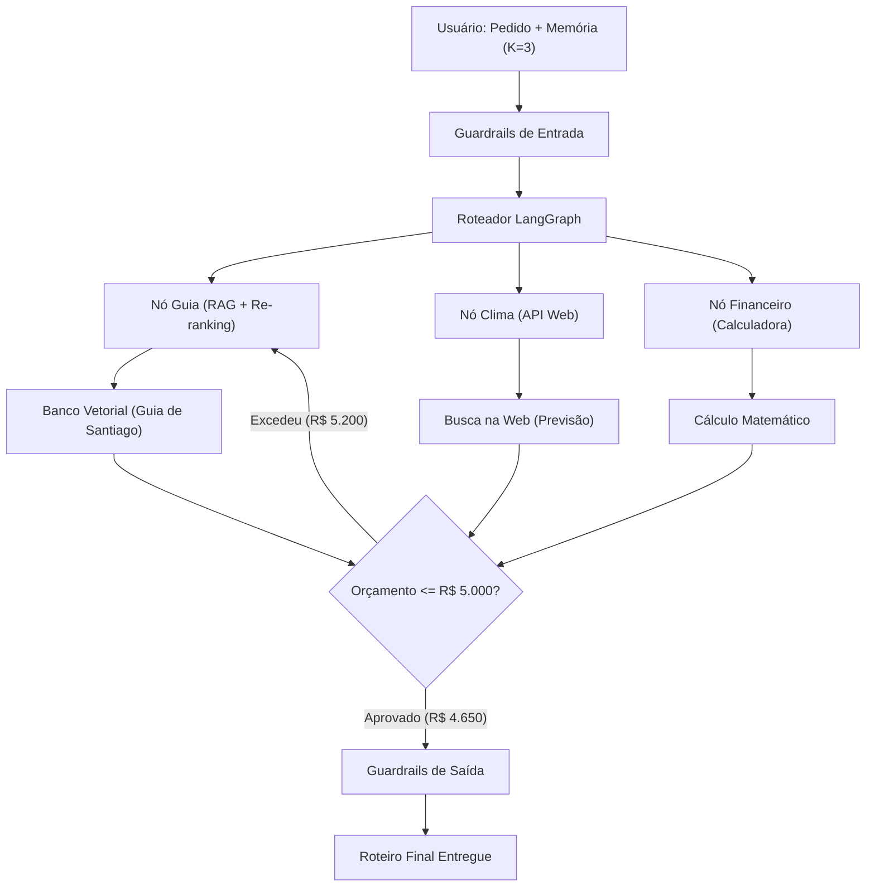

# Especificação do Deck: IA Generativa, Evolução do RAG e Sistemas Multiagentes

> **Deck:** `2026-11-05 ia-generativa-rag-agentes`  
> **Tema Visual:** `mira-dark` (Glassmorphism escuro, contraste de acentuação: Laranja `#FF904D`, Ciano `#38bdf8`, Verde `#35D07F`, Roxo `#c084fc`, Dourado `#FFC766`)  
> **Autora / Apresentadora:** Brenda Prestes  
> **Resolução & Formato:** 1920x1080 (16:9), navegação interativa card-a-card (`file://`), loop perpétuo (Regra Zero do Mira)  
> **Motor de Renderização:** D3.js v7, Tailwind CSS, Lucide Icons, SVG nativo inline, Vanilla JavaScript  

---

## 1. Visão Geral & Problema de Negócio

### 1.1 O Caso Prático Guia
- **Aplicação:** Agência de Turismo Inteligente — *"Planejador de Viagens Personalizadas para Santiago/Chile"*.
- **A Dor Real do Negócio:**
  1. Planejar roteiros customizados sob demanda (casal, família com crianças, amigos) sem trabalho braçal repetitivo.
  2. Eliminar alucinações (inventar hotéis inexistentes, horários de museus errados ou atrações fechadas).
  3. Respeitar limites financeiros estritos (orçamento fechado de **R$ 5.000**).
  4. Cruzar variáveis dinâmicas e de tempo real (previsão meteorológica para sol vs. chuva em dias de passeios abertos ou museus fechados).
  5. Cumprir contratos e parcerias comerciais da agência (priorizar cupons de desconto e hotéis parceiros).

### 1.2 Por que a Mágica é Engenharia?
A apresentação é construída para desmistificar o "hype" de inteligência artificial. Ela demonstra que uma IA não gera valor em produção operando como um modelo isolado que "chuta" palavras estatisticamente, mas sim quando estruturada como um **sistema de engenharia de software**: dados curados (RAG), validação de contratos (Pydantic), orquestração com grafos de estado (LangGraph), padronização de ferramentas (MCP), observabilidade e guardrails.

---

## 2. Objetivos de Aprendizagem & de Negócio por Macro-Assunto

| Macro-Assunto | Objetivo de Negócio | Objetivo Pedagógico & Conceitual | Objetivo de Engenharia & Produção |
| :--- | :--- | :--- | :--- |
| **Multiagentes & LangGraph** | Reduzir custos operacionais e falhas combinando especialistas com papéis delimitados. | Compreender a transição de um prompt monolítico para uma equipe colaborativa orientada a grafo cíclico de estado. | Implementar checkpoints de estado, arestas condicionais e mecanismos determinísticos de auto-correção (loops). |
| **Ingestão & RAG (Retrieval)** | Garantir que o modelo responda com a verdade factual da empresa sem alucinações. | Diferenciar recuperação de dados em tempo de inferência versus alteração dos pesos da rede neural. | Desenhar uma esteira robusta de ETL: chunking sintático/semântico, enriquecimento de metadados e indexação vetorial. |
| **Chunking vs Tokenização** | Evitar quebra arbitrária de informações e otimizar custos com consumo de tokens. | Entender a diferença entre a escala macro de engenharia de dados (chunks) e a escala micro da rede neural (tokens). | Configurar janelas de tamanho (`chunk_size`) e sobreposição (`chunk_overlap`) com `RecursiveCharacterTextSplitter`. |
| **Contratos com Pydantic** | Impedir que dados corrompidos ou mal formatados contaminem o banco vetorial e quebrem o app. | Entender o papel de schemas tipados como guardiões da comunicação entre LLMs e bancos de dados. | Forçar saídas estruturadas via JSON Schema / Pydantic com validação rigorosa de campos e enums. |
| **Embeddings & Vetores** | Permitir que o cliente encontre o que precisa mesmo sem saber o nome exato da atração. | Desmistificar a conversão de semântica e significados em coordenadas matemáticas multidimensionais. | Selecionar modelos de embedding adequados (ex.: `all-MiniLM-L6-v2`) e calcular proximidade por similaridade de cosseno. |
| **Re-Ranking** | Aumentar a precisão das recomendações e economizar janela de contexto cara do LLM. | Compreender o gargalo do bi-encoder e a necessidade de uma segunda opinião detalhada via cross-encoder. | Aplicar pipeline em dois estágios: busca aproximada em larga escala (top-K alto) seguida de reclassificação fina (top-N enxuto). |
| **Árvore & Família RAG** | Escolher a arquitetura de recuperação correta para o grau de maturidade do problema. | Mapear o ecossistema moderno: CRAG, CAG, GraphRAG, Agentic RAG, Adaptive RAG, Self-RAG e Multimodal RAG. | Implementar roteamento dinâmico de queries baseado na complexidade da pergunta. |
| **Gestão de Memória** | Manter a coerência de múltiplos turnos da conversa sem explodir custos e latência. | Compreender os limites da janela de contexto e as estratégias de retenção de memória de curto prazo. | Substituir buffers infinitos (`ConversationBufferMemory`) por buffers deslizantes (`BufferWindowMemory` com $K=3$). |
| **Padrão MCP** | Evitar acoplamento proprietário de APIs e ferramentas ao trocar ou evoluir provedores de IA. | Conhecer a arquitetura aberta do *Model Context Protocol* (Host, Cliente, Servidor). | Expor ferramentas (Tools), recursos de dados (Resources) e prompts de forma reutilizável via STDIO e HTTP/SSE. |
| **Fine-Tuning & PEFT** | Avaliar quando vale a pena ensinar o modelo e quando RAG é a escolha mais eficiente e barata. | Distinguir pré-treinamento, fine-tuning completo e ajuste eficiente por parâmetros (PEFT/LoRA/QLoRA). | Evitar esquecimento catastrófico e mitigar custos de GPU congelando a base e injetando matrizes adaptativas de baixo rank. |
| **Frameworks de Agentes** | Decidir a ferramenta técnica correta de acordo com a topologia de decisão do projeto. | Comparar as abordagens: grafos e controle determinístico (LangGraph) vs papéis pré-definidos (CrewAI) vs diálogo aberto (AutoGen). | Escolher LangGraph para casos com regras de negócio críticas, reversão de estado e auditoria passo a passo. |
| **Avaliação & Otimização RAG** | Monitorar continuamente a acurácia da busca e diminuir o footprint de memória no VectorDB. | Aprender métricas padrão de recuperação da literatura de RI: Hit Rate e MRR (Mean Reciprocal Rank). | Armazenar apenas vetores de resumo vinculados ao documento original por `Document ID` em banco relacional. |
| **Raciocínio & Decisão (ReAct)** | Tornar a tomada de decisão autônoma compreensível e auditável em vez de uma caixa preta. | Entender a lógica dedutiva, indutiva e abdutiva, além do padrão Chain of Thought (CoT) e do ciclo ReAct. | Implementar o ciclo `Pensar → Agir → Observar → Repetir` com limites rígidos de iteração. |
| **Observabilidade & Governança** | Garantir conformidade regulatória, SLA de resposta, segurança contra injeções e auditabilidade. | Entender os 3 pilares da observabilidade de IA (Traces, Logs, Metrics) e as 4 barreiras de guardrails. | Instrumentar pipelines com LangSmith / Pydantic Logfire e calcular atribuição de relevância com SHAP e LIME. |

---

## 3. Fluxo do Estudo de Caso na Apresentação (Slides 03, 05 e 15)



---

## 4. Especificação Detalhada Slide a Slide (1 a 25)

---

### Slide 01: Capa & Apresentação
- **Identificador:** `s01` / ID DOM `#mt1`
- **Título:** *Planejador Inteligente de Viagens com IA*
- **Subtítulo / Cartola:** *Santiago · Estudo de caso · IA generativa*
- **Objetivo do Assunto:** Despertar o interesse da audiência introduzindo um caso concreto e prático que conecta IA Generativa, dados reais e restrições de engenharia.
- **Pergunta Norteadora:** *"Como uma IA monta um roteiro completo para Santiago sem inventar informações?"*
- **Componente Visual & Dinâmica:** Layout Hero de impacto cinematográfico com gradiente atmosférico, badges translúcidos com efeito Glassmorphism e tipografia em escala display de 118px.
- **Animação / Regra Zero:** Pulso suave de luz de fundo e flutuação sutil de partículas em loop contínuo.

---

### Slide 02: A Demonstração do Produto
- **Identificador:** `s02` / ID DOM `#s02msg`
- **Título:** *Primeiro, a mágica.*
- **Subtítulo / Cartola:** *A demonstração · cliente · agora*
- **Objetivo do Assunto:** Apresentar a experiência final de valor do cliente antes de dissecar a infraestrutura técnica ("Show, don't just tell").
- **Conteúdo dos Dados Exibidos:**
  - Prompt digitado: *"Quero viajar para Santiago em julho, 4 dias. Somos um casal e nosso orçamento é R$ 5.000."*
  - Card 1: **Hotel parceiro · Lastarria** (4 diárias com cupom da agência: **R$ 1.950**).
  - Card 2: **Passeios, restaurantes e traslados** (Vinícola + teleférico: **R$ 1.100** · gastronomia e traslados: **R$ 1.600**).
  - Card 3: **Clima ajustado ao roteiro** (Dias 2 e 3 de sol → ar livre; dia 4 nublado → museu).
  - Card 4: **Total do Roteiro: R$ 4.650** (`R$ 1.950 + R$ 1.100 + R$ 1.600` · dentro do teto de R$ 5.000, com margem de segurança de **R$ 350**).
- **Componente Visual & Dinâmica:** Efeito de digitação em tempo real (*typing effect*) com cursor mono, seguido de três pontos pulsantes (*loading*) e cascata de cards translúcidos surgindo com transição `cubic-bezier(.22,1,.36,1)`.
- **Animação / Regra Zero:** Loop de digitação e revelação contínua da proposta para visualização persistente.

---

### Slide 03: Arquitetura de Equipe Multiagentes
- **Identificador:** `s03` / ID DOM `#s03svg`
- **Título:** *Não é um modelo. É uma equipe.*
- **Subtítulo / Cartola:** *Como a IA respondeu? · Visão geral da arquitetura*
- **Objetivo do Assunto:** Quebrar a falsa impressão de que um único prompt com um modelo gigante resolve problemas complexos e multi-variáveis.
- **Conceitos Técnicos:** Decomposição funcional de software, nós distribuídos, orquestração de fluxos assíncronos.
- **Componente Visual & Dinâmica:** Grafo vetorial SVG interativo (viewBox `0 0 1680 560`) contendo:
  - Nó Entrada: Usuário (pedido livre)
  - Nó Orquestrador: LangGraph
  - Nós Especialistas: Nó Guia (Laranja), Nó Clima (Ciano) e Nó Financeiro (Verde)
  - Nó Saída: Roteiro validado (Roxo)
- **Animação / Regra Zero:** Três pacotes de dados luminosos (*tokens*) percorrem ciclicamente as arestas do grafo em velocidades harmônicas utilizando `getTotalLength` (comprimento total do trecho) e `getPointAtLength` (interpolação da coordenada do token).

---

### Slide 04: O Dilema da Especialização
- **Identificador:** `s04`
- **Título:** *Por que dividir o trabalho?*
- **Subtítulo / Cartola:** *Agentic RAG · Especialização*
- **Objetivo do Assunto:** Contrastar analiticamente as limitações de um modelo monolítico versus a robustez de uma arquitetura de microsserviços de IA.
- **Conteúdo Comparativo:**
  - **Um LLM fazendo tudo (Monolítico):** Lê o guia, tenta prever o clima e calcula preços mentalmente. Alucina em contas matemáticas, não acessa APIs em tempo real e mistura instruções.
  - **Nós especialistas (Multiagente):**
    - *Nó Guia (RAG):* Focado estritamente no guia curado da agência.
    - *Nó Clima (API):* Consulta dados meteorológicos atualizados via Web API.
    - *Nó Financeiro (Cálculo):* Executa operações com interpretador matemático determinístico.
- **Componente Visual & Dinâmica:** Split card comparativo lado a lado com ícones de alerta para o monolito e checks de sucesso para os nós especializados.

---

### Slide 05: LangGraph & o Loop de Auto-Correção
- **Identificador:** `s05` / ID DOM `#s05svg`
- **Título:** *Um grafo que se corrige.*
- **Subtítulo / Cartola:** *LangGraph · o fluxo · Nós · Arestas · Estado*
- **Objetivo do Assunto:** Demonstrar o poder dos grafos de estados cíclicos onde a aplicação pode retroceder, renegociar escolhas e se auto-corrigir antes de entregar a resposta final.
- **Conceitos Técnicos:** `StateGraph`, arestas condicionais (*conditional edges*), propagação de estado compartilhado.
- **Componente Visual & Dinâmica:**
  - Painel com display numérico em tempo real do custo no estado (`R$ 0` → `R$ 5.200` → `R$ 4.650`).
  - Grafo horizontal com nó de decisão em losango (`≤ R$ 5.000?`).
  - Aresta condicional em vermelho (`loop`) retrocedendo ao Nó Guia.
- **Animação / Regra Zero:**
  1. O token percorre o grafo até o Nó Financeiro e a soma inicial atinge `R$ 5.200` (Hotel inicial de R$ 2.500 + Passeios R$ 1.100 + Gastronomia/Traslados R$ 1.600).
  2. O losango aponta `✗ excedeu o orçamento` em vermelho.
  3. A aresta condicional transporta o token de volta para o Guia: *"Guia troca hotel de R$ 2.500 pelo parceiro com cupom (R$ 1.950 · −R$ 550)"*.
  4. Nova soma atinge `R$ 4.650`, o losango aprova `✓ dentro do orçamento` em verde e avança até a entrega. O ciclo se repete perpetuamente.

---

### Slide 06: Fundamentos de RAG
- **Identificador:** `s06` / ID DOM `#s06grid`
- **Título:** *Onde entra o RAG?*
- **Subtítulo / Cartola:** *De onde vêm os fatos? · Retrieval-Augmented Generation*
- **Objetivo do Assunto:** Ensinar a mecânica fundamental do RAG clássico em 3 passos estruturados para ancorar o modelo na verdade de negócio.
- **Conceitos Técnicos:**
  1. **Recuperar (Retrieve):** Varre o repositório proprietário e seleciona apenas os fragmentos relevantes à pergunta do usuário.
  2. **Acrescentar (Augment):** Injeta os fragmentos recuperados no *system prompt* como contexto mandatário.
  3. **Gerar (Generate):** O LLM redige a resposta final exclusivamente fundamentada nos dados fornecidos.
- **Componente Visual & Dinâmica:** Grid em 3 blocos modulares sequenciais com badges numerados e tipografia contrastante.

---

### Slide 07: A Esteira de Ingestão de Dados
- **Identificador:** `s07` / ID DOM `#s07svg`
- **Título:** *Do PDF ao banco vetorial.*
- **Subtítulo / Cartola:** *Como nasce o RAG · Esteira de ingestão*
- **Objetivo do Assunto:** Detalhar a linha de montagem técnica necessária para preparar documentos corporativos não estruturados antes que qualquer busca seja possível.
- **Conceitos Técnicos:** Leitura e parse de PDF, particionamento de texto, enriquecimento de metadados, validação de schema e geração de vetores.
- **Componente Visual & Dinâmica:** Linha de produção fabril em SVG com 4 estações de processamento e 1 destino final (5 etapas no total):
  1. *PDF:* `guia_santiago.pdf`
  2. *Chunking:* Fatiamento em 3 cartões distintos
  3. *Etiquetas:* Classificação por IA e validação Pydantic (`✓ ChunkMeta válido`)
  4. *Embedding:* Conversão do texto para números vetoriais `[0.48, -0.19, ...]`
  5. *Banco Vetorial (Destino):* Cilindro de banco de dados populando linhas ativas.
- **Animação / Regra Zero:** Loop linear suave de 16 segundos com transições de estado sincronizadas entre texto, metadados e números.

---

### Slide 08: Chunking versus Tokenização
- **Identificador:** `s08` / ID DOM `#s08chunks`
- **Título:** *Chunk não é token.*
- **Subtítulo / Cartola:** *Duas escalas · Chunking e tokenização*
- **Objetivo do Assunto:** Esclarecer um dos erros conceituais mais comuns no ecossistema de LLMs: a confusão entre o bloco semântico de busca e a unidade atômica da rede neural.
- **Conteúdo Comparativo:**
  - **Chunk (Escala Macro):** Pedaços de documentos cortados com `RecursiveCharacterTextSplitter`, preservando contexto, tamanho configurável e sobreposição (*overlap*).
  - **Token (Escala Micro):** Pedaços de palavras e caracteres que a rede neural processa numericamente (ex.: `San` | `tiago` | `tem` | `vin` | `ícolas`).
- **Componente Visual & Dinâmica:** Visualização dividida com chips de tokens destacados em cores alternadas e blocos de chunks com códigos e metadados.

---

### Slide 09: Extração de Metadados com Pydantic
- **Identificador:** `s09`
- **Título:** *A IA etiqueta. O Pydantic fiscaliza.*
- **Subtítulo / Cartola:** *Sem trabalho manual · Metadados automáticos · exemplo do projeto*
- **Objetivo do Assunto:** Demonstrar como blindar a esteira de dados utilizando modelos leves para enriquecimento e schemas formais em código Python para validação determinística.
- **Código Python / Contrato:**
  ```python
  class ChunkMeta(BaseModel):
      categoria: Literal["hospedagem", "passeio", "restaurante"]
      perfil: list[Literal["casal", "familia"]]
      faixa_preco: Literal["baixo", "medio", "alto"]
      clima: str
  ```
- **Fluxo em 3 Etapas:**
  1. *A IA lê o chunk:* Um modelo leve classifica o trecho e propõe as etiquetas.
  2. *O Pydantic valida:* Rejeita dados ausentes ou com formato corrompido antes da inserção.
  3. *A busca filtra:* Permite filtragem híbrida instantânea (`perfil == "casal"`).
- **Componente Visual & Dinâmica:** Editor de código com sintaxe estilizada ao lado do pipeline de 3 passos de fiscalização.

---

### Slide 10: O Mecanismo de Embeddings
- **Identificador:** `s10` / ID DOM `#s10vec`
- **Título:** *Significado vira números.*
- **Subtítulo / Cartola:** *Embeddings · Similaridade ilustrativa*
- **Objetivo do Assunto:** Explicar intuitivamente como modelos de representação vetorial convertem proximidade semântica em proximidade matemática.
- **Conceitos Técnicos:** Modelo de embedding dedicado (`all-MiniLM-L6-v2`), vetores de alta dimensionalidade, cálculo de produto escalar / cosseno.
- **Exemplo Comparativo Vivo:**
  - *"vinícola"* × *"degustação de vinhos"* $\rightarrow$ **0.91** (Alta similaridade)
  - *"vinícola"* × *"parquinho infantil"* $\rightarrow$ **0.24** (Baixa relação)
- **Componente Visual & Dinâmica:** Vetor numérico dinâmico atualizado via JavaScript com barras horizontais animadas que sobem e descem conforme a comparação se repete no tempo.

---

### Slide 11: Busca Semântica no Espaço Vetorial
- **Identificador:** `s11` / ID DOM `#s11svg`
- **Título:** *Achar por significado.*
- **Subtítulo / Cartola:** *Banco vetorial · Busca semântica*
- **Objetivo do Assunto:** Visualizar a geometria da recuperação de informação em bancos vetoriais modernos.
- **Conceitos Técnicos:** Similaridade de cosseno (mede o ângulo vetorial), algoritmos de indexação rápida HNSW (*Hierarchical Navigable Small World*) e LSH (*Locality Sensitive Hashing*), engines de mercado (ChromaDB, FAISS, Qdrant).
- **Componente Visual & Dinâmica:** Canvas SVG com nuvens de pontos agrupadas em 3 clusters temáticos: *Hospedagem* (Laranja), *Passeios de Casal* (Roxo) e *Família/Crianças* (Ciano).
- **Animação / Regra Zero:** Uma sonda de busca circular pulsante viaja pelo espaço para 3 perguntas sucessivas ("hotel bonito", "vinícola para casal", "passeio com criança"), estendendo linhas tracejadas e acendendo os nós mais próximos.

---

### Slide 12: A Importância do Re-Ranking
- **Identificador:** `s12` / ID DOM `#s12list`
- **Título:** *A segunda opinião: Re-Ranking.*
- **Subtítulo / Cartola:** *Precisão · Re-ranking · exemplo ilustrativo*
- **Objetivo do Assunto:** Explicar a arquitetura em dois estágios para aliar velocidade de busca com precisão contextual profunda.
- **Conceitos Técnicos:**
  - **Bi-encoder (Busca Rápida):** Vetoriza pergunta e documento separadamente. Rápido, mas perde sutilezas de relacionamento.
  - **Cross-encoder (Reavaliação):** Passa a pergunta e o trecho concatenados juntos em uma rede BERT/RoBERTa/T5, recalculando o score com atenção total cruzada.
- **Componente Visual & Dinâmica:** Lista vertical dinâmica com 8 itens. Inicialmente ordenada por score aproximado da busca vetorial (ciano); após reavaliação pelo cross-encoder com foco em "perfil casal", os itens reordenam via transição CSS animada, destacando os 3 vencedores em verde.

---

### Slide 13: A Árvore Evolutiva da Família RAG
- **Identificador:** `s13` / ID DOM `#s13svg`
- **Título:** *Um tronco, muitos ramos.*
- **Subtítulo / Cartola:** *A família RAG · Evolução do RAG*
- **Objetivo do Assunto:** Mapear a taxonomia contemporânea de arquiteturas RAG, localizando o projeto do curso na vanguarda do *Agentic RAG*.
- **Estrutura dos Ramos Representados:**
  1. **CRAG (Corrective RAG):** Avalia e corrige a recuperação antes de acionar a geração.
  2. **CAG (Cache-Augmented Generation):** Pré-carrega o conhecimento inteiro na janela de contexto estendida sem busca.
  3. **GraphRAG:** Utiliza grafos de conhecimento (*Knowledge Graphs*) e relacionamento de entidades.
  4. **Agentic RAG (★ Nosso Projeto):** Um agente autônomo orquestra fontes, avalia suficiência e toma ações.
  5. **Adaptive RAG:** Classifica a complexidade da query para escolher a melhor estratégia.
  6. **Self-RAG:** O modelo gera tokens de reflexão para julgar se precisa buscar e criticar a própria resposta.
  7. **Multimodal RAG:** Funde texto, tabelas, imagens e diagramas no mesmo espaço vetorial.
- **Componente Visual & Dinâmica:** Tronco central emissor conectado por curvas de Bézier animadas a cada ramo com destaque iluminado (*drop-shadow neon*) no card do *Agentic RAG*.
- **Animação / Regra Zero:** Pulso de corrente elétrica viajando do tronco para cada ramo em rotação contínua.

---

### Slide 14: Gestão de Memória em Conversação
- **Identificador:** `s14` / ID DOM `#s14a` e `#s14b`
- **Título:** *A lousa que não estoura.*
- **Subtítulo / Cartola:** *Memória da conversa · Memória de curto prazo*
- **Objetivo do Assunto:** Demonstrar como gerenciar conversas multi-turno sem esgotar o orçamento de tokens nem ultrapassar limites de janela de contexto.
- **Conteúdo Comparativo:**
  - `ConversationBufferMemory`: Acumula todo o histórico linearmente. O custo por requisição cresce a cada turno até quebrar a aplicação.
  - `BufferWindowMemory` ($K=3$, Nossa Escolha): Mantém uma janela deslizante com as últimas 3 interações, garantindo custo previsível e contexto fresco.
- **Componente Visual & Dinâmica:** Duas colunas lado a lado recebendo mensagens sequenciais de um diálogo. A coluna A cresce indefinidamente; a coluna B descarta turnos antigos mantendo estritamente $K=3$ cartões ativos.

---

### Slide 15: O Fluxo Integrado Ponta a Ponta
- **Identificador:** `s15` / ID DOM `#s15svg`
- **Título:** *O fluxo completo.*
- **Subtítulo / Cartola:** *A máquina montada · De ponta a ponta*
- **Objetivo do Assunto:** Sintetizar em um único diagrama operacional todas as peças de engenharia apresentadas até este ponto.
- **Componente Visual & Dinâmica:** Diagrama SVG completo (viewBox `0 0 1700 620`) contendo:
  - Usuário com memória $K=3$
  - Guardrail de Entrada
  - Roteador LangGraph
  - 3 Nós com suas respectivas ferramentas (Banco vetorial, Busca web, Cálculo)
  - Ponto de validação de orçamento com aresta de rollback
  - Guardrail de Saída e Entrega
- **Animação / Regra Zero:** Fluxo orquestrado de esferas luminosas que percorrem o caminho, mostram o retorno na aresta de rejeição orçamentária e a validação final entregue com sucesso.

---

### Slide 16: O Padrão MCP (Model Context Protocol)
- **Identificador:** `s16` / ID DOM `#s16svg`
- **Título:** *Uma tomada universal para ferramentas.*
- **Subtítulo / Cartola:** *Model Context Protocol · Host · Cliente · Servidor*
- **Objetivo do Assunto:** Apresentar a padronização aberta da indústria criada pela Anthropic para conectar modelos de linguagem a ferramentas e bases de dados externas.
- **Pilares do Protocolo:**
  - **Tools:** Funções executáveis (consultar meteorologia, calcular orçamentos).
  - **Resources:** Dados estruturados ou binários (documentos, guias, tabelas).
  - **Prompts:** Modelos parametrizáveis reutilizáveis.
  - **Modos de Transporte:** STDIO (processo local) e HTTP com SSE (*Server-Sent Events*).
- **Componente Visual & Dinâmica:** Grafo linear horizontal conectando Usuário $\rightarrow$ Host $\rightarrow$ Cliente MCP $\rightarrow$ Servidor MCP $\rightarrow$ Ferramentas/Dados.

---

### Slide 17: Governança, Guardrails & Auditoria
- **Identificador:** `s17` / ID DOM `#s17tr`
- **Título:** *Confiável é o que dá para auditar.*
- **Subtítulo / Cartola:** *Em produção · Governança*
- **Objetivo do Assunto:** Estabelecer os critérios indispensáveis para operar sistemas autônomos em ambientes corporativos regulados e de missão crítica.
- **Conceitos Técnicos:**
  - **Guardrails:** Barreira de entrada (bloqueio de prompt injection, PII e fora de escopo) e barreira de saída (validação de orçamento e alucinações).
  - **Observabilidade:** Rastreamento de traces com LangSmith, monitoramento de latência e custo com Pydantic Logfire / OpenTelemetry.
  - **Explicabilidade:** Modelagem interpretável com SHAP e LIME.
- **Componente Visual & Dinâmica:** Painel com cartões de segurança e telemetria com badges de status de auditoria.

---

### Slide 18: Abertura do Apêndice Técnico
- **Identificador:** `s18` (divisória)
- **Título:** *Nos bastidores.*
- **Subtítulo / Cartola:** *Apêndice técnico · fora do case · Aprofundamento técnico*
- **Objetivo do Assunto:** Marcar a transição da narrativa do caso de uso de Santiago para o módulo de profundidade teórica e de engenharia avançada.
- **Eixos Temáticos Listados:**
  1. *Fine-Tuning:* LoRA & QLoRA
  2. *Agentes:* Comparativo de Frameworks
  3. *RAG:* Eficiência de vetores & métricas
  4. *Raciocínio:* Lógica formal, CoT & ReAct
  5. *Governança:* Observabilidade & Guardrails
- **Componente Visual & Dinâmica:** Card editorial imersivo com grid de 5 pilares em cartões translúcidos com bordas luminescentes.

---

### Slide 19: Fine-Tuning, LoRA & QLoRA
- **Identificador:** `s19ft`
- **Título:** *Quando RAG não basta: ensinar o modelo.*
- **Subtítulo / Cartola:** *Treinamento e adaptação · Fine-Tuning · LoRA · QLoRA*
- **Objetivo do Assunto:** Ensinar os critérios técnicos para decidir entre RAG (recuperação de contexto) e Fine-Tuning (adaptação de comportamento/estilo/domínio), além de técnicas eficientes de treinamento em GPU.
- **Conceitos Técnicos:**
  - *Pre-training vs Fine-tuning:* Modelo generalista de base versus refinamento em dataset específico de domínio.
  - *Riscos Críticos:* Esquecimento catastrófico (*catastrophic forgetting*) e sobreajuste (*overfitting*).
  - *PEFT (Parameter-Efficient Fine-Tuning):*
    - **LoRA:** Congela os pesos originais do modelo e injeta matrizes pares de baixo rank ($W = W_0 + B \cdot A$).
    - **QLoRA:** Quantiza os pesos base para 4 bits (*NormalFloat4*) reduzindo brutalmente o consumo de VRAM e aplicando adaptadores LoRA.
- **Componente Visual & Dinâmica:** Tabela comparativa e diagrama conceitual de matrizes decompostas em gradientes de memória.

---

### Slide 20: Comparativo de Frameworks de Agentes
- **Identificador:** `s20fw`
- **Título:** *Mesmo problema, três filosofias.*
- **Subtítulo / Cartola:** *Frameworks de agentes · LangGraph · CrewAI · AutoGen*
- **Objetivo do Assunto:** Capacitar arquitetos de software a escolher o framework correto para sua topologia de orquestração de IA.
- **Três Filosofias Comparadas:**
  - **LangGraph (Nosso Projeto):** Foco em engenharia de sistemas. Grafos de estado determinísticos, arestas condicionais, suporte nativo a ciclos, persistência e total controle de baixo nível.
  - **CrewAI:** Foco em metáfora de cargos humanos (*Role, Goal, Backstory*). Excelente para pipelines lineares e delegação entre agentes.
  - **AutoGen (Microsoft):** Foco em conversação dinâmica multi-agente e colaboração conversacional orientada a eventos.
- **Componente Visual & Dinâmica:** Três colunas verticais com tags coloridas, destacando o LangGraph com a badge dourada `★ NOSSO PROJETO`.

---

### Slide 21: Eficiência no VectorDB & Métricas de Avaliação RAG
- **Identificador:** `s21rag`
- **Título:** *Banco vetorial enxuto e como medir.*
- **Subtítulo / Cartola:** *Eficiência e avaliação · Document ID · Hit Rate · MRR*
- **Objetivo do Assunto:** Apresentar boas práticas de arquitetura de dados vetoriais e métricas matemáticas para avaliar a qualidade de um RAG.
- **Conceitos Técnicos:**
  - **Arquitetura de Banco Vetorial Enxuto:** Não armazenar o documento inteiro no VectorDB. Vetorizar apenas resumos ou proposições curtas acompanhados de um `Document ID`, recuperando o texto integral de um banco relacional/documental mais barato.
  - **Métricas de Avaliação de Busca:**
    - **Hit Rate:** Percentual de queries em que o trecho relevante esteve presente no top-K retornado.
    - **MRR (Mean Reciprocal Rank):** Mede a posição em que a resposta relevante apareceu:
      $$\text{MRR} = \frac{1}{|Q|} \sum_{i=1}^{|Q|} \frac{1}{\text{rank}_i}$$
- **Componente Visual & Dinâmica:** Diagrama de ponteiro vetorial $\rightarrow$ Document ID $\rightarrow$ Banco de dados, com régua de scores de MRR ($1.0$ vs $0.50$).

---

### Slide 22: Lógica de Agentes, CoT, ReAct & LAM
- **Identificador:** `s22rea`
- **Título:** *Como o agente pensa.*
- **Subtítulo / Cartola:** *Raciocínio e decisão · Lógica · CoT · ReAct · LAM*
- **Objetivo do Assunto:** Desmistificar os métodos formais de raciocínio utilizados por agentes autônomos para planejar e agir.
- **Conceitos Técnicos:**
  - **Tipos de Raciocínio:**
    - *Dedutivo:* Regra geral aplicada a caso particular.
    - *Indutivo:* Múltiplos exemplos formando um padrão.
    - *Abdutivo:* Observação de sintomas gerando a melhor hipótese explicativa.
  - **Técnicas de Raciocínio em LLMs:**
    - *Chain of Thought (CoT):* Zero-shot ("Pense passo a passo") e Few-shot (demonstração com exemplos).
    - *Ciclo ReAct:* Loop estruturado `Pensar → Agir → Observar → Repetir`.
  - **A Evolução da Automação:**
    - *RPA:* Regras fixas e telas pré-determinadas (quebra se a interface mudar).
    - *Agente de IA:* Raciocínio probabilístico e chamada de ferramentas via API.
    - *LAM (Large Action Model):* Modelos que navegam e interagem diretamente com interfaces humanas.
- **Componente Visual & Dinâmica:** Fluxo circular interativo do loop ReAct e comparativo em pirâmide de maturidade de automação.

---

### Slide 23: Observabilidade Prática (Traces, Logs & Metrics)
- **Identificador:** `s23obs` / ID DOM `#s23tr`
- **Título:** *Ver o que o agente fez.*
- **Subtítulo / Cartola:** *Observabilidade · Traces · Logs · Metrics*
- **Objetivo do Assunto:** Ensinar como rastrear grafos de agentes com ferramentas profissionais de observabilidade e métricas de desempenho.
- **Três Pilares & Ferramentas:**
  - **Traces:** Rastreamento da árvore hierárquica de nós do LangGraph via **LangSmith**.
  - **Logs:** Instrumentação estruturada e tipada em Python via **Pydantic Logfire** integrado com OpenTelemetry.
  - **Metrics:**
    - *Latência:* Tempo total de resposta e tempo gasto por nó/tool.
    - *Tokens & Custo:* Consumo de tokens de entrada vs saída por requisição.
    - *Taxa de Falha de Tools:* Erros em conexões de APIs de terceiros.
- **Componente Visual & Dinâmica:** Painel simulado de telemetria com cascata de spans temporais e cards de métricas de custo e latência.

---

### Slide 24: Explicabilidade (SHAP/LIME) & As 4 Barreiras dos Guardrails
- **Identificador:** `s24exp`
- **Título:** *Entender e proteger.*
- **Subtítulo / Cartola:** *Explicabilidade e Guardrails · LIME · SHAP · 4 Barreiras*
- **Objetivo do Assunto:** Prover garantias de conformidade ética, segurança contra agentes maliciosos e transparência de tomada de decisão.
- **Conceitos Técnicos:**
  - **Explicabilidade:**
    - *LIME:* Aproximação local linear em torno da predição.
    - *SHAP:* Baseado no Valor de Shapley da Teoria dos Jogos cooperativos, medindo a contribuição marginal de cada variável (ex.: `Orçamento: +0.42`, `Clima chuva: -0.21`).
  - **As 4 Barreiras de Defesa dos Guardrails:**
    1. *Entrada:* Filtro de prompt injection, mascaramento de PII e validação de pertinência ao escopo.
    2. *Saída:* Checagem de JSON Schema, alucinações e conformidade de tom.
    3. *Procedimental:* Teto de passos do agente, limites de gastos e veto a comandos destrutivos.
    4. *Supervisão:* Detecção contínua de anomalias com acionamento de intervenção humana (*Human-in-the-Loop*).
- **Componente Visual & Dinâmica:** Grid comparativo com gráfico de barras SHAP (verde/vermelho) ao lado dos 4 escudos concêntricos de defesa.

---

### Slide 25: Conclusão & A Órbita da Engenharia
- **Identificador:** `s25` / ID DOM `#s25orb`
- **Título:** *A mágica é engenharia.*
- **Subtítulo / Cartola:** *Voltando ao começo · Um roteiro inteligente para Santiago, com informações confiáveis e dentro do orçamento.*
- **Assinatura:** Brenda Prestes
- **Objetivo do Assunto:** Fechar a apresentação com síntese inspiradora, unindo todos os conceitos aprendidos em torno da mensagem de que o sucesso de aplicações de IA está na excelência da engenharia.
- **Componente Visual & Dinâmica:**
  - Sistema orbital em tela cheia com 10 elipses de conceitos gravitando em coordenadas trigonométricas contínuas:
    `Tokens` · `Chunks` · `Embeddings` · `Banco vetorial` · `Re-ranking` · `RAG` · `LangGraph` · `Agentes` · `MCP` · `Guardrails`
  - Tipografia central imponente com destaque gradiente e agradecimento final.
- **Animação / Regra Zero:** Órbita elíptica contínua (período de 40s) via `frameLoop` em JavaScript com rotação suave e persistente.

---

## 5. Inventário de Animações & Conformidade com a Regra Zero do Mira

> **Regra Zero do Mira:** Toda animação entra com coreografia e depois continua em loop interno perpétuo. Animação estática é proibida.

| Slide | ID Cena / SVG | Tipo de Animação | Mecanismo de Loop Interno |
| :--- | :--- | :--- | :--- |
| **01** | `#mt1` | Background dinâmico + tipografia display | Pulso suave de opacidade e gradiente de fundo perpétuo. |
| **02** | `s02` / `#s02msg` | Digitação de prompt + cascata de cards | Ciclo assíncrono com digitação letra a letra, loading e revelação dos cards a cada 5,2 segundos. |
| **03** | `s03` / `#s03svg` | Grafo de nós e fluxo de tokens | `frameLoop` de 6 segundos com 3 tokens percorrendo os caminhos do SVG via `getTotalLength` e `getPointAtLength`. |
| **05** | `s05` / `#s05svg` | LangGraph com aresta condicional e contador | `mkScene` assíncrona calculando valor de R$ 0 a 5.200, disparo do loop vermelho e auto-correção para R$ 4.650 (−R$ 550 no hotel parceiro). |
| **07** | `s07` / `#s07svg` | Esteira fabril de ingestão (PDF $\rightarrow$ Vetor) | `frameLoop` contínuo de 16 segundos com transformação interpolada entre texto, tags e vetores. |
| **10** | `s10` / `#s10vec` | Vetor de embedding e barras de similaridade | `setInterval` alternando valores numéricos a cada 700ms e transição de barras de 0% a 91% a cada 7s. |
| **11** | `s11` / `#s11svg` | Espaço vetorial 2D com dispersão de clusters | `mkScene` com sonda de busca pulsante viajando entre 3 perguntas e conectando aos clusters via linhas tracejadas. |
| **12** | `s12` / `#s12list` | Reordenação viva de lista por Re-Ranking | `mkScene` ordenando inicialmente por busca rápida e reordenando por cross-encoder com transição CSS fluida. |
| **13** | `s13` / `#s13svg` | Árvore evolutiva da Família RAG | Desenho progressivo de paths de Bézier com pulso de partículas percorrendo cada ramo sequencialmente. |
| **14** | `s14` / `#s14a,b` | Buffer de memória infinito vs janela deslizante | Adição contínua de turnos de diálogo demonstrando o custo crescente na coluna A e a estabilidade na coluna B. |
| **15** | `s15` / `#s15svg` | Grafo completo do fluxo multiagente ponta a ponta | `mkScene` com tokens percorrendo entrada, nó roteador, ferramentas em paralelo, rollback orçamentário e saída. |
| **16** | `s16` / `#s16svg` | Arquitetura Model Context Protocol | Pulso sequencial de pacotes entre Usuário, Host, Cliente MCP, Servidor MCP e Tools. |
| **25** | `s25` / `#s25orb` | Sistema orbital com 10 conceitos fundamentais | `frameLoop` de 40 segundos com cálculo trigonométrico (`Math.cos`, `Math.sin`) em órbita elíptica contínua. |

---

## 6. Glossário Técnico & Rastreabilidade de Referências

As especificações deste deck foram elaboradas em conformidade direta com os materiais didáticos e referências do projeto:
- `references/cursos-fundamentos-rag-agentes.pdf`
- `references/pdf-texto.txt`
- `references/_tema.md`

| Termo / Conceito | Definição Técnica no Contexto da Apresentação | Slide Chave |
| :--- | :--- | :--- |
| **Transformer** | Arquitetura de rede neural com mecanismo de atenção e processamento em paralelo que substituiu modelos sequenciais (RNNs/LSTMs). | Slide 12, 19 |
| **Tokenizador** | Mecanismo que fatia texto em pedaços atômicos e mapeia cada pedaço para um identificador numérico único (Token ID). | Slide 08 |
| **Chunking** | Fatiamento de documentos extensos em blocos de tamanho e sobreposição controlados para viabilizar indexação semântica. | Slide 08 |
| **Pydantic** | Biblioteca de validação de dados e parsing baseada em type hints de Python, usada como contrato entre LLMs e sistemas de backend. | Slide 09 |
| **Embedding** | Representação de texto como um vetor em espaço vetorial contínuo denso multidimensional onde proximidade geométrica reflete proximidade semântica. | Slide 10 |
| **Similaridade de Cosseno** | Métrica matemática que calcula o cosseno do ângulo entre dois vetores para determinar grau de parentesco temático, variando de -1 a 1. | Slide 11 |
| **Bi-Encoder** | Modelo que gera representações vetoriais separadas para query e documento, permitindo busca veloz em índices vetoriais. | Slide 12 |
| **Cross-Encoder** | Modelo que analisa simultaneamente o par pergunta-documento com mecanismo de atenção total, gerando score de relevância de alta precisão. | Slide 12 |
| **Agentic RAG** | Padrão onde um agente autônomo utiliza o mecanismo de RAG como uma ferramenta dinâmica, decidindo quando e como buscar dados. | Slide 13 |
| **LangGraph** | Framework da LangChain baseado em grafos de estados direcionados, com suporte nativo a fluxos cíclicos, persistência e auto-correção. | Slide 05, 15, 20 |
| **MCP (Model Context Protocol)** | Protocolo aberto da Anthropic que padroniza como aplicações de IA acessam ferramentas (Tools), recursos de dados (Resources) e prompts. | Slide 16 |
| **LoRA / QLoRA** | Métodos de fine-tuning eficiente que congelam a rede neural base e treinam apenas matrizes adaptativas de baixo rank, com quantização em 4 bits no QLoRA. | Slide 19 |
| **ReAct (Reason + Act)** | Paradigma de execução em agentes que entrelaça raciocínio em linguagem natural com ações externas e observação dos resultados. | Slide 22 |
| **Guardrails** | Camadas de segurança programáticas que interceptam prompts e respostas para garantir conformidade de escopo, dados sensíveis e segurança. | Slide 17, 24 |
| **SHAP / LIME** | Algoritmos de interpretabilidade e explicabilidade em IA que medem a contribuição matemática de cada variável de entrada para a decisão final. | Slide 24 |

